# HealthTrack AI
### Yapay Zekâ Destekli Kişisel Sağlık Verilerinin Analizi, Takibi ve Akıllı Bilgilendirme Sistemi

HealthTrack AI; kan tahlilleri, vitamin değerleri, tansiyon, kilo, uyku ve fiziksel aktivite gibi kişisel sağlık verilerinin tek bir platformda saklanmasını, zaman içindeki değişimlerinin grafiklerle izlenmesini, geçmiş ölçümlerle karşılaştırılmasını ve anlaşılır açıklamalarla yorumlanmasını sağlayan bir web uygulamasıdır.

> ⚠️ **Önemli:** Bu uygulama bir teşhis veya tedavi sistemi değildir. Amacı, kullanıcının sağlık verilerini anlamlandırmasına ve doktoruyla görüşürken kullanabileceği düzenli bilgilere sahip olmasına yardımcı olmaktır. Uygulamadaki demo hesaplarında bulunan tüm sağlık verileri **sentetiktir** ve gerçek kişilere ait değildir.

---

## İçindekiler
1. [Hızlı Başlangıç](#-hızlı-başlangıç)
2. [Demo Hesapları](#-demo-hesapları)
3. [Özellikler](#-özellikler)
4. [Ekran Görüntüleri](#-ekran-görüntüleri)
5. [Tasarım Sistemi](#-tasarım-sistemi)
6. [Kullanılan Teknolojiler](#-kullanılan-teknolojiler)
7. [Mimari ve Veritabanı](#-mimari-ve-veritabanı)
8. [Güvenlik](#-güvenlik)
9. [Analiz ve Yapay Zekâ](#-analiz-ve-yapay-zekâ)
10. [Docker Komutları ve Yönetim](#-docker-komutları-ve-yönetim)
11. [Testler](#-testler)
12. [Gelecek Çalışmalar](#-gelecek-çalışmalar)

---

## 🚀 Hızlı Başlangıç

Bilgisayarda yalnızca **Docker Desktop** kurulu olması yeterlidir. Python, Node.js veya veritabanı kurulumu gerekmez.

1. Docker Desktop'ı kurun ve çalıştırın: https://www.docker.com/products/docker-desktop/
2. Projeyi indirin (GitHub'da **Code → Download ZIP** veya `git clone`) ve klasörüne girin:
   ```bash
   cd Saglik-Analiz-Uygulama
   ```
3. Uygulamayı başlatın:
   ```bash
   docker compose up --build
   ```
4. Tarayıcıda açın: **http://localhost:8080**

İlk çalıştırmada (internet hızına göre birkaç dakika) şunlar otomatik yapılır:
- Backend ve frontend derlenir,
- SQLite veritabanı oluşturulur ve migration'lar uygulanır,
- Yönetici ve örnek kullanıcı hesapları, sentetik sağlık verileri, örnek raporlar ve örnek sistem logları yüklenir.

> **İsteğe bağlı ayarlar:** Şifreleri, portu veya Gemini API anahtarını değiştirmek için `.env.example` dosyasını `.env` adıyla kopyalayıp düzenleyin (`cp .env.example .env`, Windows: `Copy-Item .env.example .env`). `.env` dosyası yoksa varsayılan demo ayarları kullanılır. 8080 portu doluysa `.env` içinde `APP_PORT=8090` gibi farklı bir port verilebilir.

### Bilgisayar olmadan çalıştırma (GitHub Codespaces)
Uygulama, telefon veya tablet tarayıcısından da bulutta çalıştırılabilir:
1. GitHub'da depo sayfasında **Code → Codespaces → Create codespace** seçin.
2. Codespace açıldığında uygulama otomatik olarak derlenip başlatılır (ilk açılış 3-5 dakika sürebilir). Durumu terminalde `docker compose ps` ile görebilirsiniz.
3. **Ports** sekmesinde **8080** portunun yanındaki 🌐 bağlantısını açın.
4. Başka birine göstermek için portun üzerine sağ tıklayıp (mobilde uzun basıp) **Port Visibility → Public** seçin ve bağlantıyı paylaşın.

### Aynı ağdaki telefondan erişim
Uygulama bir bilgisayarda çalışırken, aynı Wi-Fi ağındaki telefondan `http://<bilgisayarın-yerel-IP-adresi>:8080` adresiyle açılabilir (ör. `http://192.168.1.25:8080`). Arayüz mobil uyumludur.

---

## 🔑 Demo Hesapları

| Rol | Kullanıcı adı / E-posta | Şifre |
|---|---|---|
| Yönetici (ADMIN) | `admin` veya `admin@healthtrack.local` | `Admin.Demo2026` |
| Kullanıcı (USER) | `ayse@healthtrack.local` – Ayşe Demir | `Demo.User2026` |
| Kullanıcı (USER) | `mehmet@healthtrack.local` – Mehmet Yılmaz | `Demo.User2026` |
| Kullanıcı (USER) | `elif@healthtrack.local` – Elif Kaya | `Demo.User2026` |

Giriş ekranındaki "Demo hesapları" etiketlerine tıklanarak kullanıcı adı otomatik doldurulabilir.

Her demo kullanıcı farklı bir sağlık senaryosu içerir:
- **Ayşe Demir:** Demir eksikliği takibi. Hemoglobin, ferritin ve B12 değerleri zamanla iyileşiyor; D vitamini hâlâ düşük.
- **Mehmet Yılmaz:** Prediyabet ve kolesterol takibi. HbA1c, LDL ve tansiyon iyileşme eğiliminde ancak bazı değerler hâlâ referans dışında; kilo azalıyor.
- **Elif Kaya:** Tiroid takibi. TSH değeri tedavi süreciyle normal aralığa dönüyor.

Her kullanıcıda 4 farklı tarihte laboratuvar sonuçları (hemogram, biyokimya, vitamin/mineral, tiroid), 12 aylık tansiyon, nabız, kilo, uyku ve adım kayıtları, biri kayıtlara aktarılmış ve biri onay bekleyen iki PDF rapor ve örnek bir asistan sohbeti bulunur.

> 🔒 Demo şifreleri yalnızca yerel sunum ortamı içindir. Gerçek kullanımda `.env` dosyasında tüm şifreler ve `JWT_SECRET` değiştirilmeli, `ENVIRONMENT=production` ayarlanmalıdır. Bu modda demo hesapları oluşturulmaz.

---

## ✨ Özellikler

### Kullanıcı
- **Dashboard:** Karşılama alanı, BMI ve özet kartlar, öne çıkan göstergeler, zaman içindeki değişim grafiği, son ölçümler, son raporlar ve hızlı işlemler. Veri yoksa kullanıcıyı yönlendiren boş ekran tasarımları.
- **Sağlık Profilim:** Doğum tarihi, cinsiyet, boy, kilo, kan grubu, kronik durumlar, ilaçlar, alerjiler; otomatik BMI hesaplama.
- **Sağlık Verilerim:** Tahlil/ölçüm kayıtlarının eklenmesi, düzenlenmesi, silinmesi; kategori ve başlığa göre filtreleme, sayfalama.
- **Ölçümlerim:** Gösterge bazında geçmiş, referans bantlı grafikler, en düşük/en yüksek/ortalama değerler, iki tarih arasındaki değişimin karşılaştırılması.
- **Raporlarım:** PDF/PNG/JPEG rapor yükleme, PDF metin çıkarma ve görsellerde OCR. Çıkarılan değerler kullanıcı kontrol edip onaylamadan kaydedilmez.
- **Analizler:** Referans aralığı karşılaştırması, önceki ölçüme göre değişim, eğilim hesabı, öne çıkan bulgular ve analiz geçmişi.
- **Yapay Zekâ Asistanı:** Kullanıcının kendi verileri, uygulama kullanımı ve genel sağlık bilgisi hakkında kaynak gösteren sohbet asistanı.
- **Ayarlar:** Açık/koyu tema (tercih hatırlanır), hesap bilgileri, şifre değiştirme, oturum kapatma.

### Yönetici
- **Yönetici Dashboard:** Toplam/aktif kullanıcı, sağlık kaydı, rapor ve başarısız giriş sayıları, 14 günlük aktivite grafiği, son kayıtlar ve son işlemler.
- **Kullanıcı Yönetimi:** Arama, rol ve durum filtreleri, kullanıcı detayı, hesabı aktif/pasif yapma, yeni kullanıcı oluşturma.
- **Sistem Logları:** Tarih, kullanıcı, işlem türü ve sonuç filtreleri, metin arama, sayfalama; en yeni kayıtlar üstte.
- **Sistem İstatistikleri:** İşlem türü dağılımı, kayıt kategorileri, hesap durumu ve demo verisi durumu.
- Yönetici rolü, kullanıcıların sağlık **değerlerine** otomatik erişim sağlamaz; yalnızca hesap bilgileri ve sayısal özetler gösterilir.

### Arayüz
- Sağlık teknolojisi odaklı, merkezi olarak yönetilen tasarım sistemi (ayrıntılar aşağıda).
- Özgün logo, daraltılabilir lacivert sidebar, kullanıcı profil alanı ve tema anahtarı; mobilde açılır menü; geri/ileri navigasyon butonları.
- Mobil, tablet ve masaüstü uyumlu responsive tasarım.
- Yüklenme, hata, boş durum ve başarılı işlem bildirimleri.

---

## 📸 Ekran Görüntüleri

| Giriş | Dashboard |
|---|---|
| 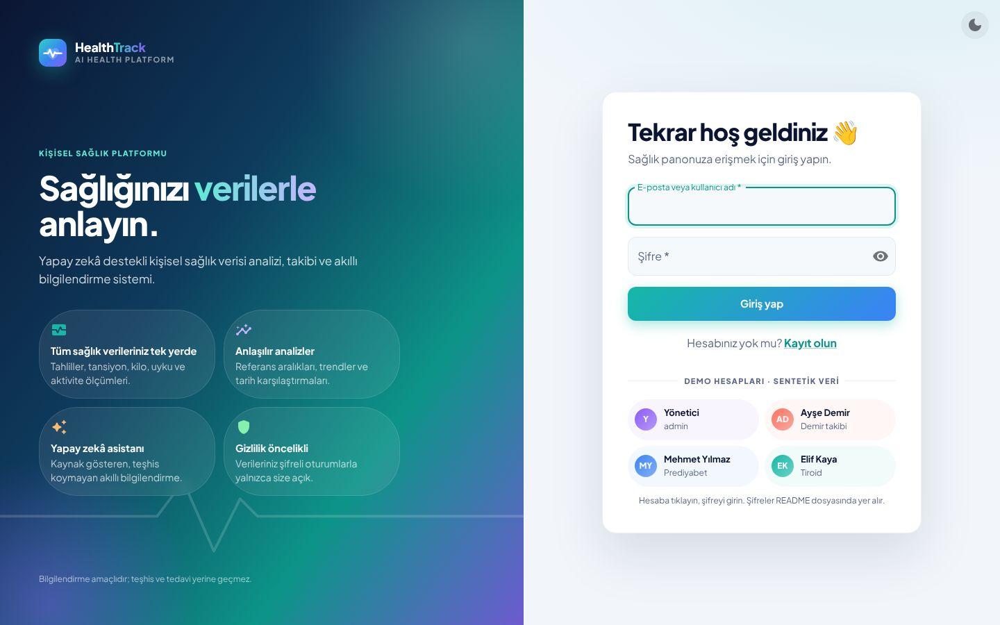 | 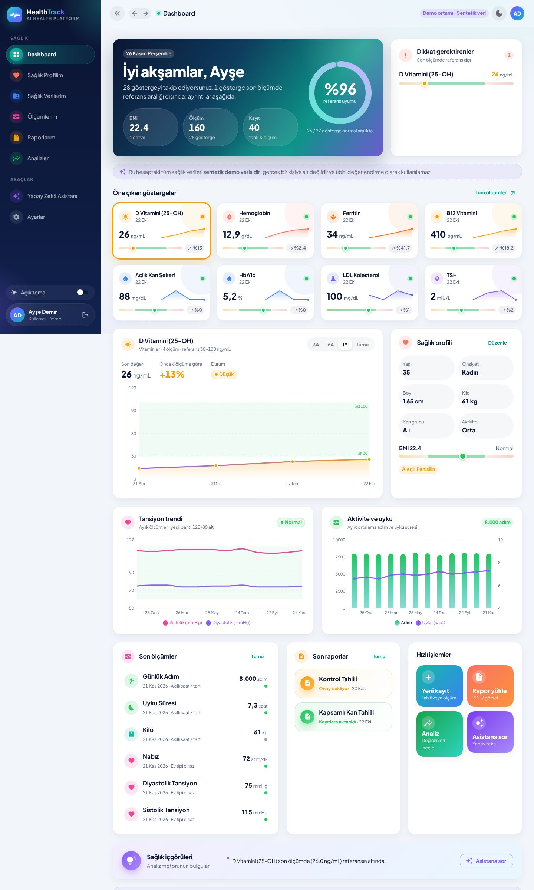 |
| **Dashboard – koyu tema** | **Ölçümler ve trend grafiği** |
| 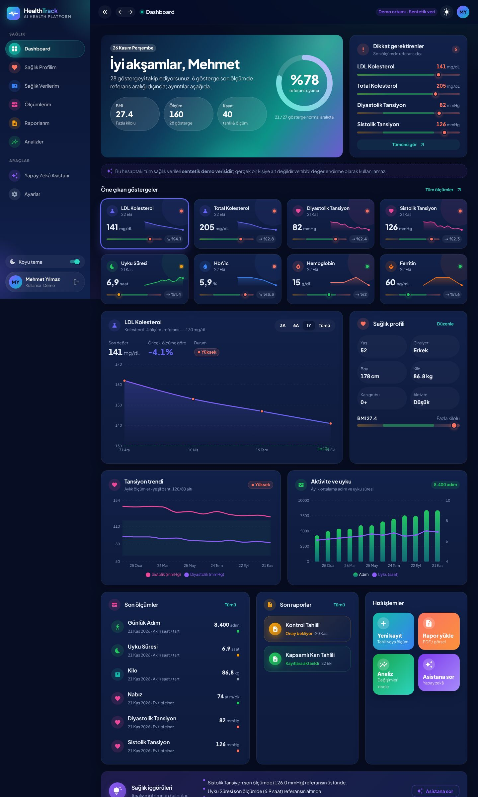 | 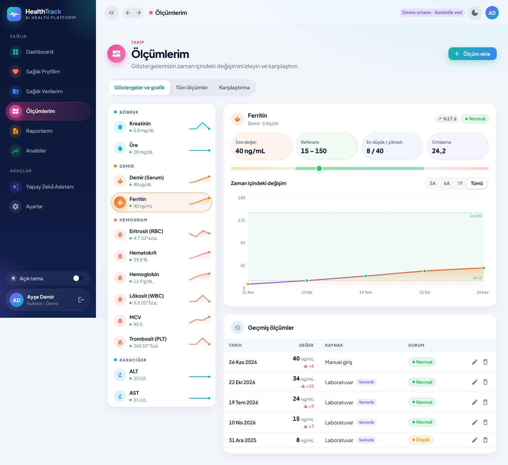 |
| **Sağlık verileri** | **Rapor inceleme ve onay** |
| 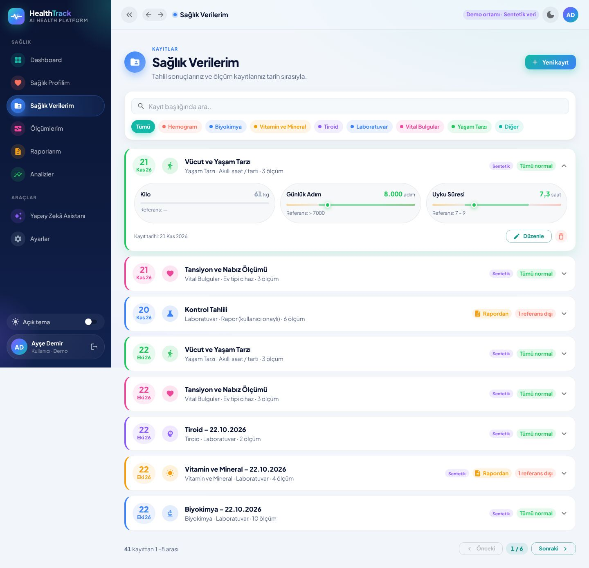 | 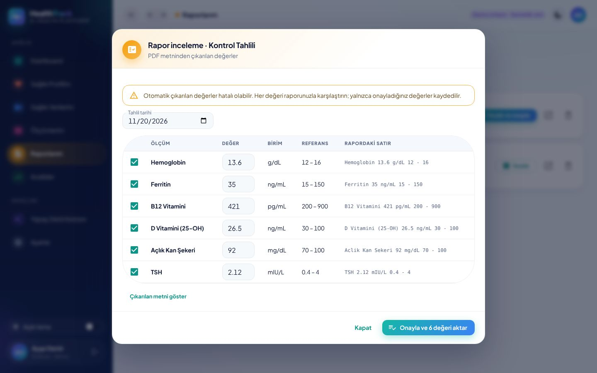 |
| **Analizler** | **Yapay zekâ asistanı** |
| 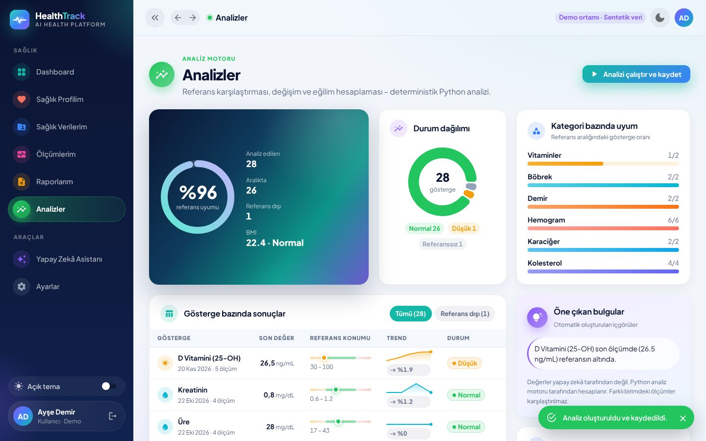 | 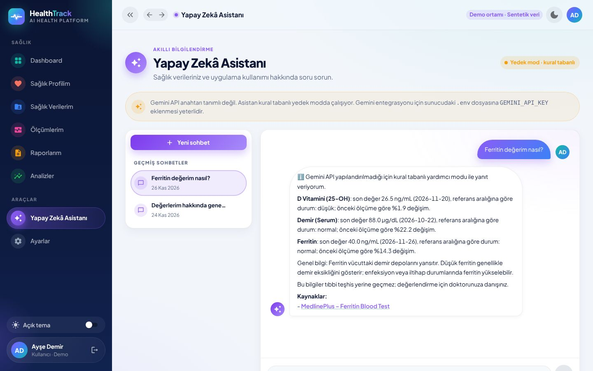 |
| **Sağlık profili** | **Yönetici dashboard** |
| 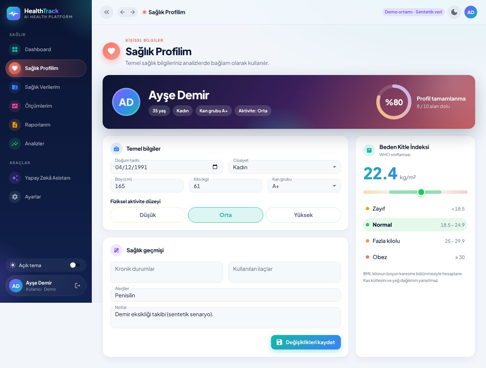 | 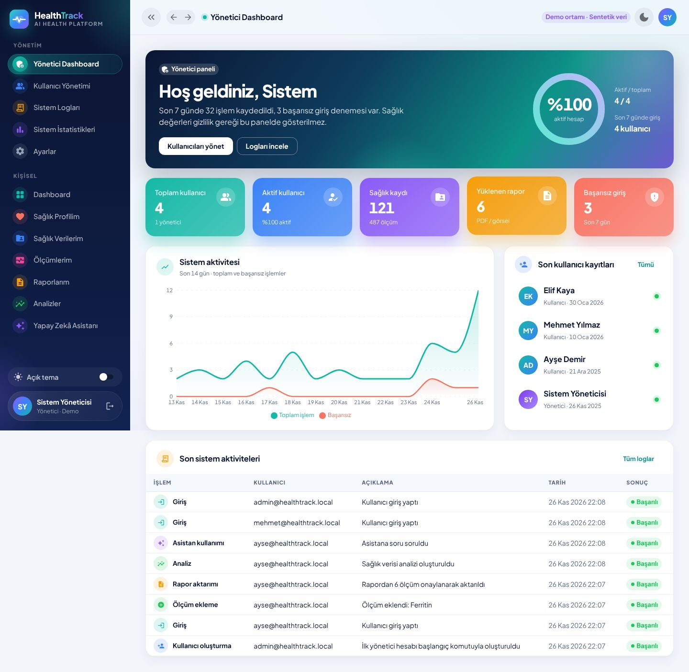 |
| **Sistem logları** | **Mobil görünüm** |
| 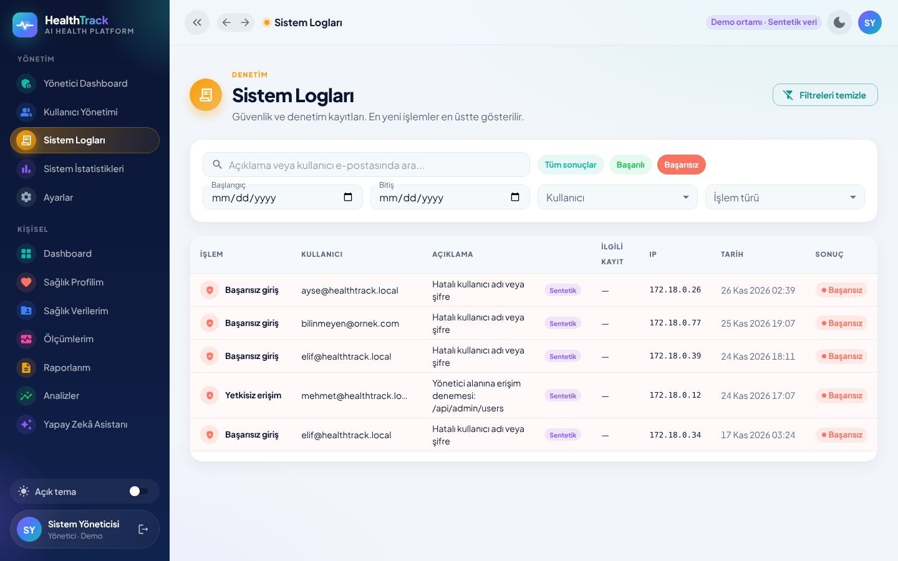 | 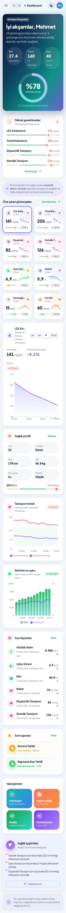 |

---

## 🎨 Tasarım Sistemi

Arayüz, modern sağlık platformlarından ilham alan özgün bir görsel kimlikle tasarlanmıştır. Tüm renkler, gradientler, tipografi ve bileşen stilleri `frontend/src/theme.ts` dosyasında merkezi olarak tanımlanır; ekranlar ortak bileşenlerden (`frontend/src/components/common.tsx`) oluşur.

**Renk rolleri** – her rengin tek ve tutarlı bir anlamı vardır:

| Renk | Kullanım amacı |
|---|---|
| 🟢 Turkuaz / teal | Marka rengi, birincil butonlar, aktif menü |
| 🔵 Derin lacivert | Sidebar, koyu yüzeyler, başlıklar (güven ve derinlik) |
| 🔷 Mavi | Bilgi, biyokimya göstergeleri, ikincil veri serileri |
| 🟣 Mor / lavanta | Yapay zekâ asistanı, analiz ve içgörüler, tiroid |
| ✅ Yeşil | "Normal" durum, referans aralığı bantları |
| 🟠 Amber | "Düşük" durum, dikkat, vitaminler, raporlar |
| 🔴 Mercan | "Yüksek" durum, uyarılar, hemogram |
| 🩷 Pembe | Vital bulgular (tansiyon, nabız) |

Her ölçüm kategorisinin sabit bir rengi ve ikonu vardır; aynı gösterge dashboard'da, listelerde ve grafiklerde aynı renkle görünür.

**Veri görselleştirme bileşenleri** (tamamı gerçek kullanıcı verisiyle çalışır):
- **Referans uyumu halkası:** son ölçümde referans aralığında olan göstergelerin oranı.
- **Referans konum çubuğu:** değerin referans aralığına göre konumu (yeşil bölge = normal aralık).
- **Sparkline'lar:** her göstergenin ölçüm geçmişinin mini trend çizgisi.
- **Gradient alan grafikleri:** referans bandı, durum renkli noktalar ve dönem filtresi (3A / 6A / 1Y / Tümü).
- **Karşılaştırmalı grafikler:** iki tarih arasındaki yüzde değişim çubukları, aylık tansiyon ile aktivite ve uyku grafikleri.

**Temalar:** Açık tema ferah, renkli bir zemin kullanır; koyu tema derin lacivert yüzeyler ve renk vurgularıyla premium bir görünüm sunar. Sidebar her iki temada da lacivert kalarak içerikten net biçimde ayrılır. Tercih tarayıcıda hatırlanır.

**Etkileşim:** Sayfa geçişlerinde yumuşak animasyonlar, kart ve butonlarda hover efektleri, ikonlu modal başlıkları, iskelet yükleme ekranları, açıklayıcı boş durum ekranları ve bildirimler. Hareket azaltma tercihi olan kullanıcılar için animasyonlar otomatik kapatılır.

---

## 🧰 Kullanılan Teknolojiler

| Katman | Teknoloji |
|---|---|
| Frontend | React 18, TypeScript, Vite, Material UI, Recharts |
| Backend | Python 3.12, FastAPI, SQLAlchemy 2, Pydantic 2 |
| Veritabanı | SQLite, Alembic (migration yönetimi) |
| Veri analizi | Pandas, NumPy, scikit-learn |
| Rapor işleme | pypdf (PDF metni), Tesseract OCR (görseller) |
| Yapay zekâ | Google Gemini API (isteğe bağlı) |
| Kurulum | Docker, Docker Compose, Nginx |

---

## 🏗️ Mimari ve Veritabanı

Proje, gereksiz karmaşıklıktan kaçınmak için **modüler monolit** yapısında geliştirilmiştir: tek bir backend servisi ve statik olarak sunulan bir frontend. Nginx, frontend'i sunar ve `/api` isteklerini backend'e iletir. Böylece uygulama tek bir adresten (aynı origin) çalışır ve backend dış dünyaya kapalı kalır.

```
Tarayıcı ──► Nginx (frontend, :8080) ──/api──► FastAPI (backend) ──► SQLite (kalıcı Docker volume)
```

SQLite bağlantısı SQLAlchemy üzerinden yönetilir; foreign key desteği, WAL modu ve kilitlenme bekleme süresi etkinleştirilmiştir. İleride PostgreSQL'e geçmek için yalnızca `DATABASE_URL` değerinin değiştirilmesi yeterlidir.

**Tablolar:** `users`, `health_profiles`, `measurement_types`, `health_records`, `health_measurements`, `uploaded_documents`, `document_extractions`, `analyses`, `chat_sessions`, `chat_messages`, `refresh_tokens`, `audit_logs`

- Bir **sağlık kaydı** (ör. "Hemogram – Mart 2026") birden fazla **ölçüm** içerir.
- Her ölçüm; ad, değer, birim, tarih, referans aralığı, veri kaynağı ve açıklama bilgisini tutar. Aynı ölçümün farklı tarihlerdeki değerleri tarihsel olarak saklanır.
- **Ölçüm kataloğu** 28 göstergeyi standart birim ve referans aralıklarıyla tanımlar (hemogram, B12, D vitamini, demir, ferritin, glikoz, HbA1c, kolesterol, karaciğer ve böbrek testleri, tiroid, tansiyon, nabız, kilo, uyku, adım).

### Klasör yapısı
```
backend/
  app/
    main.py            Uygulama girişi, güvenlik başlıkları, hata yönetimi
    config.py          Ortam değişkenleri
    database.py        Veritabanı bağlantısı
    models.py          Veritabanı modelleri
    schemas.py         İstek/yanıt şemaları
    security.py        Şifreleme, JWT, oturum yönetimi, yetkilendirme
    audit.py           Merkezi log kaydı
    seed.py, cli.py    Başlangıç verileri ve yönetim komutları
    routers/           auth, profile, records, measurements, documents, analysis, assistant, admin
    services/          analiz motoru, rapor metni çıkarma, yapay zekâ, bilgi tabanı, ölçüm kataloğu
  alembic/             Veritabanı migration'ları
  tests/               API testleri
frontend/
  src/
    theme.ts           Tasarım sistemi
    api/               API istemcisi ve tipler
    auth/              Oturum yönetimi
    components/        Ortak bileşenler (layout, kartlar, grafikler, formlar)
    pages/             Kullanıcı ve yönetici sayfaları
  nginx.conf           Web sunucusu ve API yönlendirmesi
docker-compose.yml
```

---

## 🔐 Güvenlik

Uygulama sağlık verisi işlediği için güvenlik tasarımın merkezindedir:

- **Şifreler** bcrypt algoritmasıyla hashlenerek saklanır.
- **Kimlik doğrulama:** 15 dakikalık kısa ömürlü JWT access token yalnızca tarayıcı belleğinde tutulur (localStorage kullanılmaz). Refresh token HttpOnly, SameSite=Strict cookie ile taşınır ve veritabanında yalnızca hash'i saklanır.
- **Refresh token rotation:** Her yenilemede token değiştirilir. Kullanılmış bir token tekrar gelirse (çalınma şüphesi) o oturum zincirinin tamamı iptal edilir. Çıkış, şifre değişikliği ve hesabın pasifleştirilmesi açık oturumları sonlandırır.
- **CSRF koruması:** Cookie tabanlı yenileme ve çıkış isteklerinde double-submit token kontrolü yapılır.
- **Ortam ayrımı:** Yerel HTTP demo ortamı ile HTTPS üretim ortamının cookie ayarları ayrıdır; üretim modunda zayıf anahtar veya güvensiz cookie ile uygulama başlamaz.
- **Yetkilendirme:** Her istekte backend tarafında rol ve sahiplik kontrolü yapılır. Kullanıcılar yalnızca kendi verilerine erişebilir; başka bir kullanıcının kaydına erişim denemesi reddedilir ve loglanır.
- **Dosya yükleme:** Dosya türü uzantıya değil dosya içeriğine göre doğrulanır, boyut sınırı uygulanır, dosyalar rastgele adlarla saklanır ve yalnızca sahibine sunulur.
- **Diğer önlemler:** Başarısız giriş denemesi sınırlaması, ORM ile parametreli sorgular (SQL injection koruması), Content-Security-Policy ve güvenlik başlıkları, hassas bilgi içermeyen hata mesajları.
- **Loglar:** Şifre, token, rapor içeriği veya sağlık değerleri loglara yazılmaz. Loglar yalnızca backend tarafında oluşturulur ve yalnızca yönetici tarafından görüntülenebilir.
- **Container güvenliği:** Container'lar root olmayan kullanıcılarla ve `no-new-privileges` ayarıyla çalışır; backend portu dışarıya açılmaz.

---

## 🤖 Analiz ve Yapay Zekâ

**Deterministik analiz motoru (Python):** Tıbbi değerler yapay zekâ modeline hesaplatılmaz. Analiz Pandas ve NumPy ile yapılır:
- Son değerin referans aralığıyla karşılaştırılması (düşük / normal / yüksek),
- Önceki ölçüme göre değişim ve yüzde değişim,
- En az üç ölçüm varsa doğrusal eğilim (30 günlük değişim hızı),
- Farklı birimdeki ölçümlerin karşılaştırmadan çıkarılması, tek ölçüm ve eski veri uyarıları.

**Yapay zekâ asistanı:**
- Gemini API ile çalışacak şekilde tasarlanmıştır. API anahtarı yalnızca backend'de, `.env` dosyasındaki `GEMINI_API_KEY` değişkeninde tutulur.
- Anahtar tanımlı değilse uygulama hata vermez; arayüzde bilgilendirme gösterilir ve asistan, kullanıcının analiz sonuçlarına dayanan kural tabanlı yedek modda yanıt verir.
- Modele kullanıcının adı veya e-postası gönderilmez; yalnızca analiz motorunun hesapladığı özet gönderilir.
- Sistem talimatları teşhis, tedavi ve ilaç önerisini engeller; belirsizliğin belirtilmesini ve kaynak gösterilmesini ister.
- **RAG altyapısının başlangıcı:** MedlinePlus, NIH, CDC, WHO ve AHA gibi güvenilir kaynaklardan derlenmiş bilgi tabanında scikit-learn TF-IDF ile arama yapılır ve ilgili kaynaklar yanıta eklenir.

---

## 🐳 Docker Komutları ve Yönetim

| İşlem | Komut |
|---|---|
| Başlatma | `docker compose up --build` |
| Arka planda başlatma | `docker compose up -d --build` |
| Durdurma (veriler korunur) | `docker compose down` |
| Yeniden başlatma | `docker compose up -d` |
| Logları izleme | `docker compose logs -f` |
| Servis durumu | `docker compose ps` |

**Verilerin saklanması:** Veritabanı ve yüklenen raporlar `healthtrack-data` adlı kalıcı Docker volume'unda tutulur. Container'ların durdurulması veya yeniden oluşturulması verileri silmez.

> ⚠️ `docker compose down -v` komutu volume'u siler; **tüm veritabanı ve yüklenen raporlar kalıcı olarak kaybolur.** Yalnızca uygulamayı tamamen sıfırlamak için kullanılmalıdır.

**Başlangıç verileri (seed):** Container her başladığında migration'lar ve başlangıç verisi kontrolü otomatik çalışır. Bu işlem tekrarlanabilir: mevcut kullanıcıları ve verileri silmez, çoğaltmaz.

```bash
# Demo verilerini sıfırlayıp yeniden oluşturma (yalnızca demo kayıtlarını etkiler)
docker compose exec backend python -m app.cli reset-demo

# Yeni yönetici hesabı oluşturma
docker compose exec backend python -m app.cli create-admin --email yonetici@ornek.com --password 'GucluBirSifre123!'

# Veritabanı yedeği alma
docker compose exec backend python -m app.cli backup
docker cp healthtrack-backend:/app/database/backups ./yedekler
```

**İlk yönetici hesabı** kaynak koda yazılmaz; `ADMIN_EMAIL`, `ADMIN_USERNAME` ve `ADMIN_PASSWORD` ortam değişkenlerinden, hesap yoksa oluşturulur.

**İnternet erişimi kısıtlı ortamlar:** Görsel OCR için Tesseract, Debian paket deposundan kurulur. Bu depoya erişim yoksa `.env` içine `INSTALL_OCR=false` yazılabilir; uygulama OCR olmadan çalışmaya devam eder.

### Docker olmadan geliştirme ortamı
```bash
# Backend
cd backend
python -m venv .venv && source .venv/bin/activate      # Windows: .venv\Scripts\activate
pip install -r requirements-dev.txt
cp ../.env.example .env
alembic upgrade head && python -m app.cli init
uvicorn app.main:app --reload --port 8000

# Frontend (ayrı terminalde)
cd frontend
npm install && npm run dev                              # http://localhost:5173
```

---

## 🧪 Testler

```bash
cd backend && pytest -q
```

Otomatik testler şunları doğrular:
- Başlangıç verilerinin tekrar çalıştırıldığında çoğalmaması,
- Hatalı giriş ve rol bazlı erişim kısıtlaması,
- Kullanıcılar arası veri izolasyonu ve yetkisiz erişimin loglanması,
- Refresh token rotation, CSRF koruması ve çalınmış token tespiti,
- Sağlık kaydı ekleme, düzenleme, silme ve analiz; gelecek tarihli veri reddi,
- PDF rapor yükleme → değer çıkarma → kullanıcı onaylı aktarım; sahte dosya reddi,
- Yapay zekâ asistanının API anahtarı olmadan çalışması,
- Yöneticinin hesabı pasif hâle getirmesi.

Ayrıca Docker ile temiz kurulum, yeniden başlatma sonrası veri kalıcılığı ve tüm sayfaların masaüstü, mobil ve koyu temada çalışması kontrol edilmiştir.

---

## 🔭 Gelecek Çalışmalar

- Bilimsel makale ve kılavuzlardan oluşan geniş bir belge deposu ile embedding tabanlı RAG.
- Yaş ve cinsiyete göre kişiselleştirilmiş referans aralıkları.
- Farklı laboratuvar rapor formatları için gelişmiş ayrıştırma şablonları.
- Yöneticinin arayüzden yeni ölçüm türü tanımlayabilmesi.
- Akıllı saat ve sağlık uygulamalarından otomatik veri aktarımı.
- Çok kullanıcılı üretim ortamı için PostgreSQL ve dağıtık oturum sınırlaması.

---

## ⚖️ Yasal Uyarı

HealthTrack AI bilgilendirme amaçlı bir projedir. Sunulan analizler ve asistan yanıtları tıbbi teşhis, tedavi veya profesyonel sağlık danışmanlığı yerine geçmez. Sağlıkla ilgili kararlar için mutlaka bir sağlık profesyoneline başvurulmalıdır.
